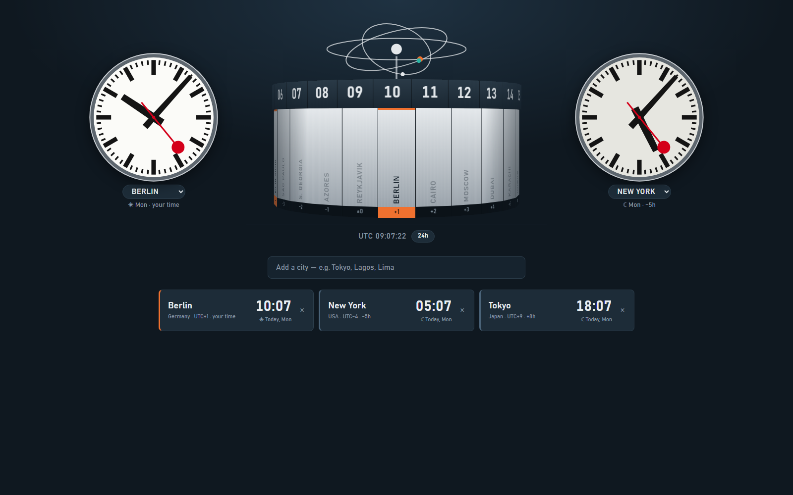
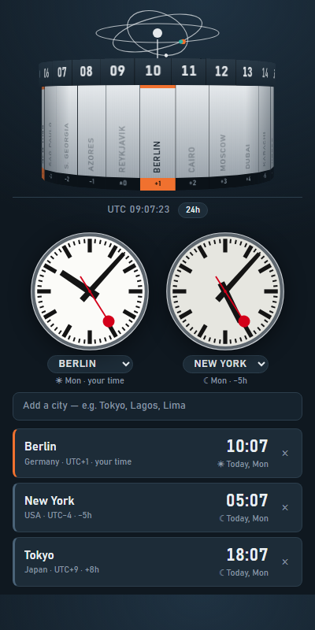

# Weltzeituhr — World Clock (Chrome extension)

A world clock modeled on the Weltzeituhr at Alexanderplatz, Berlin: a 24-sided column whose
hour ring shows the current hour in every time zone, topped by the atom-model sculpture —
flanked by two Swiss railway clocks for the cities you care about most.

**New tab page**

**Toolbar popup**

## Download & install

1. **[Download the ZIP](https://github.com/echorohit/world-clock/archive/refs/heads/main.zip)** and unzip it
   (or `git clone https://github.com/echorohit/world-clock.git`).
2. Open `chrome://extensions` in Chrome.
3. Turn on **Developer mode** (top right).
4. Click **Load unpacked** and select the unzipped `world-clock` folder (the one containing `manifest.json`).
5. Pin the extension from the puzzle-piece menu and click its icon.
6. Open a new tab — Chrome asks once whether to keep the new tab page; choose **Keep it**.

Works in any Chromium browser that supports Manifest V3 (Chrome, Edge, Brave, Arc…).

## Use

- **Add a city:** type in the search box (≈130 curated cities plus every IANA time zone), then pick with ↑/↓ + Enter or click.
- **The column:** faces holding your cities are marked orange; faint names are the column's own reference plaques.
  Drag or scroll to turn it; click a city in the list to turn its face to the front.
- **Moves like the real one:** the hour ring turns around the fixed column once a day (15° an hour), so each number
  glides from face to face — at half past, it sits halfway between two faces. The atom model on top turns once a minute.
- **List:** local time, day/night, Today/Tomorrow/Yesterday, UTC offset and the difference from your time.
  Drag rows to reorder, × to remove.
- **Swiss clocks:** two SBB-style railway clocks; pick each one's city from the dropdown under it (any city in your list).
  The red second hand sweeps in 58.5 s, rests at 12, then the minute hand jumps — like the real thing.
- **12h / 24h:** toggle next to the UTC readout.
- **New tab:** every new tab shows the clock at full size, with the Swiss clocks either side of the column.
  To go back to Chrome's default new tab, remove the `chrome_url_overrides` block from `manifest.json` and reload the extension.

Cities and settings sync through `chrome.storage.sync`.
